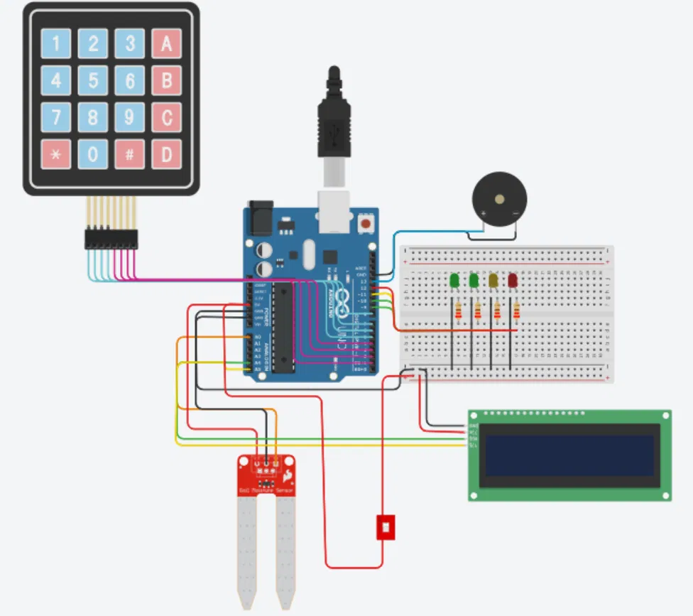

# Indicador de Nível de Água com Arduino


Este projeto foi desenvolvido para a disciplina **Internet das Coisas**. O objetivo é monitorar o nível de água com um sensor resistivo e avisar visualmente e sonoramente quando o nível sobe.

O Arduino recebe o sinal do sensor, acende LEDs, controla o buzzer, mostra os dados em um LCD e permite mudar o limite de perigo usando um teclado.

<p align="center">
  
</p>

## Conteúdo

- [Objetivo do projeto](#objetivo-do-projeto)
- [Componentes](#componentes)
- [Ligações](#ligações)
- [Funcionamento](#funcionamento)
- [Teclas do teclado](#teclas-do-teclado)
- [Como executar](#como-executar)
- [Calibração](#calibração)
- [Simulação no Tinkercad](#simulação-no-tinkercad)
- [Testes realizados](#testes-realizados)
- [Limitações](#limitações)
- [Estrutura do projeto](#estrutura-do-projeto)
- [Autores](#autores)

## Objetivo do projeto

Criar um protótipo capaz de indicar o nível aproximado de água e avisar quando o limite configurado for atingido.

O sistema utiliza:

- LEDs para indicar as faixas de nível;
- um buzzer para emitir os alertas;
- um display LCD para mostrar a leitura;
- um teclado para controlar o buzzer e salvar o limite;
- a memória EEPROM para manter o limite após desligar o Arduino.

> A leitura não representa uma medida exata em centímetros. Ela depende da calibração e das características do sensor utilizado.

## Componentes

| Quantidade | Componente | Finalidade |
| ---: | --- | --- |
| 1 | Arduino Uno R3 | Controla o sensor, LEDs, buzzer, LCD e teclado |
| 1 | Sensor resistivo de nível de água | Mede o nível pela leitura analógica |
| 1 | LCD 16×2 com módulo I2C | Mostra a leitura, o percentual e o estado do buzzer |
| 1 | Teclado matricial 4×3 | Permite mudar o som e gravar o limite |
| 1 | Buzzer | Emite o alerta sonoro |
| 2 | LEDs verdes | Indicam os níveis de 25% e 50% |
| 1 | LED amarelo | Indica o nível de 75% |
| 1 | LED vermelho | Indica o limite de perigo |
| 4 | Resistores de 220 Ω | Protegem os LEDs |
| 1 | Protoboard | Montagem do circuito |
| - | Fios jumper e cabo USB | Ligações e alimentação |

Lista completa: [lista de componentes da montagem física](componentes/lista_componentes_prototipo_real.csv).

<p align="center">
  
</p>

## Ligações

| Pino do Arduino | Ligação |
| --- | --- |
| `A0` | Sinal `S` do sensor de nível |
| `5V` | Terminal positivo `+` do sensor e VCC do LCD |
| `GND` | Terminal negativo `-` do sensor, GND do LCD, buzzer e LEDs |
| `A4` / `SDA` | SDA do LCD |
| `A5` / `SCL` | SCL do LCD |
| `D8`, `D7`, `D6`, `D5` | Linhas do teclado 4×3 |
| `D4`, `D3`, `D2` | Colunas do teclado 4×3 |
| `D9` | LED verde 1, com resistor de 220 Ω |
| `D10` | LED verde 2, com resistor de 220 Ω |
| `D11` | LED amarelo, com resistor de 220 Ω |
| `D12` | LED vermelho, com resistor de 220 Ω |
| `D13` | Positivo do buzzer |

### Mapa do teclado

| Linha | Teclas | Pino |
| :---: | :---: | :---: |
| 1 | `1` `2` `3` | `D8` |
| 2 | `4` `5` `6` | `D7` |
| 3 | `7` `8` `9` | `D6` |
| 4 | `*` `0` `#` | `D5` |

As três colunas correspondem, nesta ordem, aos pinos `D4`, `D3` e `D2`.

> Antes de ligar o teclado, confira a posição das linhas e colunas no modelo utilizado. Os terminais podem variar conforme o fabricante.

## Funcionamento

O sensor envia uma leitura analógica para o pino `A0`. O código considera `600` como o valor máximo e converte a leitura em uma porcentagem entre 0% e 100%.

Os LEDs ficam ligados da seguinte forma:

| Leitura | LEDs ligados | Buzzer |
| --- | --- | --- |
| 0 a 149 | Nenhum | Silencioso |
| 150 a 299 | Verde 1 | Silencioso |
| 300 a 449 | Verde 1 e verde 2 | Silencioso |
| 450 até antes do limite | Verde 1, verde 2 e amarelo | Bip lento |
| Limite ou leitura maior | Todos os LEDs | Alerta acelerado |

O limite inicial é `480`, que corresponde a 80% do valor máximo considerado pelo programa.

Quando o nível atinge o limite, o LCD mostra `PERIGO: 100%`. Essa mensagem significa que o limite configurado foi atingido, não que o sensor esteja completamente submerso.

### O que aparece no LCD

| Linha | Conteúdo |
| --- | --- |
| Primeira linha | Leitura bruta do sensor e estado do som: `SOM` ou `MUDO` |
| Segunda linha | `Nivel: xx%` ou `PERIGO: 100%` |

A tela é atualizada aproximadamente a cada 120 ms.

## Teclas do teclado

| Tecla | Função |
| :---: | --- |
| `1` | Desliga o buzzer |
| `2` | Liga o buzzer |
| `3` | Salva a leitura atual como novo limite de perigo |
| `#` | Mostra as informações das teclas no LCD por 1 segundo |

Ao pressionar `3`, o limite é salvo no endereço `0` da EEPROM. Dessa forma, o valor continua armazenado após desligar ou reiniciar o Arduino.

Na primeira inicialização, o sistema usa o limite padrão `480` caso não exista um valor válido salvo.

## Como executar

### Materiais necessários

- Arduino Uno;
- cabo USB;
- componentes da [lista do projeto](componentes/lista_componentes_prototipo_real.csv);
- [Arduino IDE](https://www.arduino.cc/en/software).

### Bibliotecas

| Biblioteca | Como instalar | Uso |
| --- | --- | --- |
| `Wire` | Já vem na Arduino IDE | Comunicação I2C |
| `EEPROM` | Já vem na Arduino IDE | Gravação do limite |
| `LiquidCrystal I2C` | Gerenciador de Bibliotecas | Controle do LCD |
| `Keypad` | Gerenciador de Bibliotecas | Leitura do teclado |

### Passo a passo

1. Monte o circuito seguindo a tabela de [ligações](#ligações).
2. Abra o arquivo [`codigo/Indicador_Nivel_Agua.ino`](codigo/Indicador_Nivel_Agua.ino) na Arduino IDE.
3. Instale as bibliotecas `LiquidCrystal I2C` e `Keypad`, caso ainda não estejam disponíveis.
4. Selecione **Arduino Uno** em **Ferramentas > Placa**.
5. Selecione a porta correta em **Ferramentas > Porta**.
6. Clique em **Verificar** e depois em **Carregar**.
7. Acompanhe os LEDs e as mensagens no LCD.

No código, o endereço do LCD é definido como `0x27` e os pinos do teclado seguem o mapa apresentado anteriormente.

## Calibração

1. Deixe o sensor seco e confirme que os LEDs estão apagados.
2. Confirme que o buzzer está silencioso.
3. Molhe o sensor aos poucos e observe os LEDs em 150, 300 e 450.
4. Coloque o nível que deverá ser considerado perigoso.
5. Pressione a tecla `3` para salvar esse valor.
6. Reinicie o Arduino e confira se o mesmo limite continua ativo.

Se o sensor utilizado atingir uma leitura diferente de `600` quando estiver completamente molhado, ajuste esta linha no código:

```cpp
const int VALOR_MAX_SENSOR = 600;
```

Também é possível alterar o limite inicial:

```cpp
int limiteCheio = 480;
```

Os valores do limite entre `101` e `600` são aceitos na EEPROM. O limite padrão retorna a `480` caso o valor salvo não esteja nessa faixa.

## Simulação no Tinkercad

Abra o projeto da simulação:

[](https://www.tinkercad.com/things/gcfk48sRPLc-projeto-sa-prevencao-de-alagamentos-residenciaias/editel?sharecode=hNlV0GFYj3YyVG4pCysihhe0_Woj0avjWztFcsteBuY)

### Diferenças entre o simulador e o projeto físico

| Item | Tinkercad | Protótipo físico |
| --- | --- | --- |
| Sensor | Sensor de umidade do solo | Sensor resistivo de nível de água |
| Teclado | 4×4 | 4×3 |
| LCD I2C | Endereço informado como `0x20` | Endereço usado no código: `0x27` |
| Interruptor DIP | Aparece na montagem exportada | Não é usado pelo programa |

O Tinkercad não possui exatamente todos os componentes usados na montagem real. Por isso, a exportação original foi mantida como referência da simulação, enquanto a lista física é a recomendada para montar o protótipo real.

- [Lista original exportada pelo Tinkercad](componentes/bom_tinkercad_original.csv)
- [Notas sobre componentes](componentes/README.md)
- [Notas sobre a simulação](simulador/README.md)

## Testes realizados

Os testes abaixo podem ser usados como roteiro de avaliação:

| Teste | Ação | Resultado esperado |
| --- | --- | --- |
| Inicialização | Reiniciar o Arduino | LCD informa que o sistema está pronto |
| Sensor seco | Não molhar o sensor | Nenhum LED ligado e buzzer silencioso |
| 25% | Nível próximo de 150 | Verde 1 ligado |
| 50% | Nível próximo de 300 | Verde 1 e verde 2 ligados |
| 75% | Nível próximo de 450 | LEDs verdes e amarelo ligados; buzzer começa a apitar |
| Limite | Atingir o limite configurado | Todos os LEDs ligados e alerta acelerado |
| Tecla `1` | Pressionar `1` | Buzzer silenciado |
| Tecla `2` | Pressionar `2` | Buzzer reativado |
| Tecla `3` | Pressionar `3` | Valor atual salvo na EEPROM |
| Tecla `#` | Pressionar `#` | Mensagem de ajuda no LCD |
| Reinicialização | Desligar e ligar novamente | Limite configurado permanece salvo |

## Limitações

- Durante as mensagens exibidas no LCD, o programa aguarda por 1 segundo e não atualiza o sensor nesse intervalo.
- Um limite inferior a `450` pode acender o LED vermelho antes de o alerta sonoro começar.
- Valores entre `101` e `599` são recomendados para o limite.
- O limite `600` pode causar problema no cálculo da velocidade do alerta crítico.
- O texto `MUDO` pode ficar apertado no lado direito do LCD.
- O sensor pode variar conforme a condutividade da água, a oxidação e a sujeira nas trilhas.
- A tecla `#` apenas mostra o menu por alguns segundos.
- Os valores medidos são aproximados e o protótipo não substitui equipamentos profissionais de prevenção contra alagamentos.

## Estrutura do projeto

```text
projeto-iot/
├── codigo/
│   └── Indicador_Nivel_Agua.ino
├── componentes/
│   ├── README.md
│   ├── lista_componentes_prototipo_real.csv
│   └── bom_tinkercad_original.csv
├── docs/
│   └── Documentacao_SA_Indicador_Nivel_Agua.pdf
├── imagens/
│   ├── montagem-tinkercad.png
│   └── sensor-nivel-agua-real.png
├── simulador/
│   └── README.md
├── .gitignore
└── README.md
```

Documentação técnica completa: [PDF do projeto](docs/Documentacao_SA_Indicador_Nivel_Agua.pdf).

## Autores

Projeto desenvolvido para a disciplina **Internet das Coisas** do **SENAI/SC**, turma **TDESS V01/2025**.

| Nome | Função |
| --- | --- |
| Caetano Gbur Petry | Estudante |
| Guilherme Arthur Silveira | Estudante |
| Sergio Luiz da Silveira | Docente |
