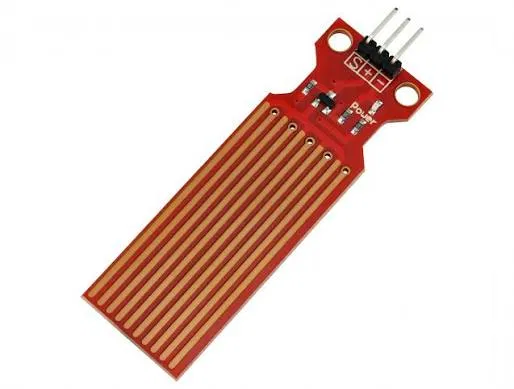

# Indicador de Nível de Água com Arduino UNO

Protótipo de monitoramento de nível de água com **Arduino UNO**, alertas visuais por LEDs, avisos sonoros por buzzer, informações no display LCD e ajuste do limite de perigo pelo teclado matricial.

Projeto desenvolvido para a avaliação prática da unidade curricular **Internet das Coisas (IoT)** do **SENAI/SC**.

**Integrantes:** Caetano Gbur Petry e Guilherme Arthur Silveira  
**Turma:** TDESS V01/2025  
**Professor:** Sergio Luiz da Silveira

> **Importante:** a imagem acima representa a **simulação no Tinkercad**. A versão física utiliza outro sensor de água e um teclado **4×3**, conforme descrito abaixo. O sensor de umidade do solo do CSV de exportação **não é o sensor utilizado no protótipo real**.

## Sobre o projeto

A proposta é acompanhar a elevação da água em um reservatório e emitir alertas conforme a leitura analógica do sensor. O Arduino atualiza quatro LEDs progressivamente, mostra a leitura e o estado do buzzer no LCD 16×2, e permite salvar na EEPROM uma leitura de referência para a condição de perigo.

Este é um **protótipo didático**: os valores dependem da calibração do sensor e **não representam uma medição de altura em centímetros**. A porcentagem exibida utiliza como referência o valor experimental 600.

## Componentes do protótipo físico

| Quantidade | Componente | Função |
| :--: | --- | --- |
| 1 | Arduino UNO R3 | Controle geral do circuito |
| 1 | Sensor resistivo de nível de água, 3 pinos (`S`, `+`, `-`) | Leitura analógica do contato com a água |
| 1 | LCD 16×2 com módulo I2C | Exibição da leitura, avisos e comandos |
| 1 | Teclado de membrana matricial **4×3** | Controle do buzzer e gravação do limite |
| 1 | Buzzer piezoelétrico passivo | Alerta sonoro |
| 2 | LEDs verdes | Indicações iniciais de nível |
| 1 | LED amarelo | Alerta intermediário |
| 1 | LED vermelho | Indicação de perigo |
| 4 | Resistores de 220 Ω | Limitação de corrente dos LEDs |
| 1 | Protoboard | Montagem do circuito |
| Conforme montagem | Fios jumper e cabo USB | Conexões e alimentação |

A listagem em CSV está em [`componentes/lista_componentes_prototipo_real.csv`](componentes/lista_componentes_prototipo_real.csv).

### Atenção à diferença entre simulação e montagem real

| Item | Tinkercad / exportação original | Montagem física / código fornecido |
| --- | --- | --- |
| Sensor | Identificado como **sensor de umidade do solo** | **Sensor resistivo de nível de água** (foto abaixo) |
| Teclado | **4×4** | **4×3** (4 linhas e 3 colunas) |
| LCD I2C | Exportação menciona módulo com endereço **0x20** | O código usa `LiquidCrystal_I2C` no endereço **0x27** |
| Interruptor DIP | Presente na exportação de componentes do Tinkercad | Não é utilizado pelo código `.ino` informado; presença na montagem real não confirmada |

O CSV original foi preservado **somente como referência da simulação**, em [`componentes/bom_tinkercad_original.csv`](componentes/bom_tinkercad_original.csv). **Não use esse CSV como lista de compras do protótipo real.**

## Funcionamento

O Arduino lê o sensor pelo pino `A0` e acende os LEDs de forma **acumulativa**.

| Leitura analógica | Comportamento dos LEDs | Buzzer (quando habilitado) |
| --- | --- | --- |
| Abaixo de 150 | Todos apagados | Desligado |
| 150 a 299 | 1º verde aceso | Desligado |
| 300 a 449 | 2 verdes acesos | Desligado |
| A partir de 450 | 2 verdes + amarelo | Bipes de alerta |
| A partir do limite configurado | LED vermelho também acende | Bipes críticos **se a leitura for ≥ 450** |

**Detalhes da calibração:** o valor máximo de referência do sensor está definido como `600`; o limite de perigo padrão é `480`, mas pode ser alterado e salvo pelo teclado. Por isso, o LCD pode mostrar `PERIGO: 100%` ao atingir o **limite configurado**, mesmo que a porcentagem calculada em relação a 600 ainda seja inferior a 100%.

### Comandos do teclado 4×3

| Tecla | Função |
| :--: | --- |
| `1` | Silenciar o buzzer |
| `2` | Reativar o buzzer |
| `3` | Salvar a **leitura atual** como limite de perigo na EEPROM |
| `#` | Exibir uma ajuda temporária no LCD |

**Observação:** embora a operação desejada mencione segurar `#`, o código disponibilizado atualmente mostra o menu **ao pressionar** a tecla. Não há detecção de pressão longa. O projeto **não possui mais cronômetro nem histórico de tempos**.

## Ligações elétricas de referência (código físico)

| Pino do Arduino UNO | Componente / ligação |
| --- | --- |
| `A0` | Sinal `S` do sensor de água |
| `5V` / `GND` | Alimentação `+` / `-` do sensor; alimentação do LCD e terra comum |
| `A4` (SDA) / `A5` (SCL) | Comunicação I2C do LCD |
| `D8`, `D7`, `D6`, `D5` | Linhas 1 a 4 do teclado 4×3, nesta ordem |
| `D4`, `D3`, `D2` | Colunas 1 a 3 do teclado 4×3, nesta ordem |
| `D9` / `D10` | LEDs verdes 1 e 2 (cada um com resistor) |
| `D11` | LED amarelo (com resistor) |
| `D12` | LED vermelho (com resistor) |
| `D13` | Positivo do buzzer; negativo ao `GND` |

Confira a pinagem **real** do teclado e do módulo do LCD antes de conectar: a ordem dos terminais pode variar entre fabricantes. Consulte a [documentação técnica](docs/Documentacao_Tecnica.pdf) para mais detalhes.

## Código e bibliotecas

**Código-fonte:** [`codigo/Indicador_Nivel_Agua/Indicador_Nivel_Agua.ino`](codigo/Indicador_Nivel_Agua/Indicador_Nivel_Agua.ino).

A implementação utiliza:

- `Wire.h` — comunicação I2C (incluída com a plataforma Arduino);
- `LiquidCrystal_I2C.h` — controle do LCD 16×2 I2C;
- `Keypad.h` — leitura do teclado matricial;
- `EEPROM.h` — armazenamento não volátil do limite (incluída na plataforma Arduino AVR).

Para carregar no Arduino físico:

1. Instale e abra a **Arduino IDE**.
2. Instale as bibliotecas `LiquidCrystal_I2C` e `Keypad` pelo Gerenciador de Bibliotecas, se necessário.
3. Abra `codigo/Indicador_Nivel_Agua/Indicador_Nivel_Agua.ino`.
4. Selecione a placa **Arduino Uno** e a porta serial correta.
5. Confirme o endereço I2C do LCD (`0x27` no código), a pinagem e a montagem; depois compile e envie para a placa.

> O código foi mantido conforme o arquivo fornecido para este repositório. Não foram feitas alterações silenciosas para adaptar o teclado 4×4 do simulador ao 4×3 físico.

## Simulação no Tinkercad

**[Abrir projeto no Tinkercad](https://www.tinkercad.com/things/gcfk48sRPLc-projeto-sa-prevencao-de-alagamentos-residenciaias/editel?returnTo=https%3A%2F%2Fwww.tinkercad.com%2Fdashboard&sharecode=hNlV0GFYj3YyVG4pCysihhe0_Woj0avjWztFcsteBuY)**

A montagem do simulador usa componentes equivalentes disponíveis na plataforma, que **não necessariamente correspondem aos componentes da montagem física**. A fotografia do circuito está em [`imagens/montagem-tinkercad.png`](imagens/montagem-tinkercad.png). O endereço I2C e o teclado físico 4×3 devem ser considerados ao transportar o projeto entre a simulação e o Arduino real.

A execução do link e a compatibilidade integral do `.ino` físico com o Tinkercad **não foram verificadas** durante a organização deste repositório.

## Organização do repositório

| Pasta / arquivo | Conteúdo |
| --- | --- |
| `codigo/Indicador_Nivel_Agua/` | Sketch `.ino` da versão física |
| `componentes/` | Lista correta do protótipo físico e CSV original exportado do Tinkercad |
| `docs/` | Documentação técnica em PDF e DOCX, critérios do professor, histórico e roteiro de testes |
| `docs/historico/` | PDF da documentação antiga, preservado como referência histórica |
| `imagens/` | Foto do sensor real e captura da montagem no Tinkercad |
| `imagens/prototipo-fisico/` | Destinado às futuras fotos da montagem real |
| `simulador/` | Link e informações de reprodução no Tinkercad |

