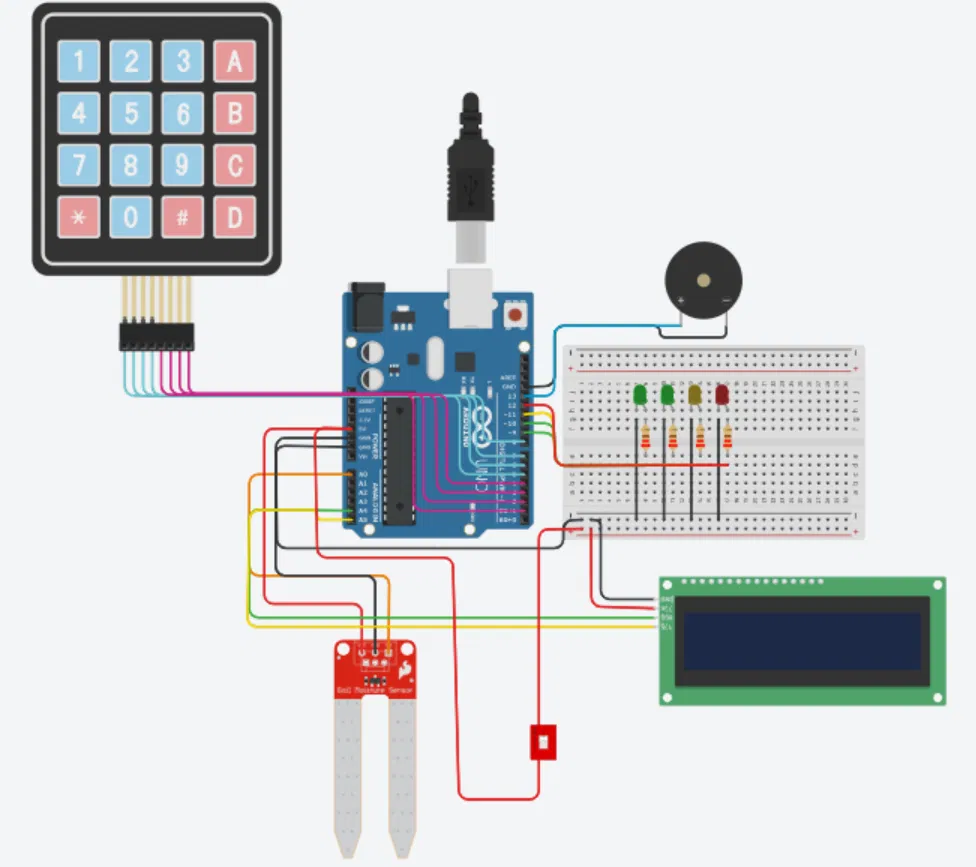

# Simulação no Tinkercad

**Projeto:** https://www.tinkercad.com/things/gcfk48sRPLc-projeto-sa-prevencao-de-alagamentos-residenciaias/editel?returnTo=https%3A%2F%2Fwww.tinkercad.com%2Fdashboard&sharecode=hNlV0GFYj3YyVG4pCysihhe0_Woj0avjWztFcsteBuY

## Diferenças relevantes

- No Tinkercad, a montagem apresentada utiliza teclado **4×4**; na montagem física e no código `.ino` fornecido, o teclado é **4×3**.
- O CSV exportado pelo simulador identifica o sensor como **sensor de umidade do solo**. A montagem física usa o **sensor resistivo de nível de água** mostrado em `../imagens/sensor-nivel-agua-real.png`.
- A lista exportada menciona endereço I2C **0x20**; o código físico utiliza LCD no endereço **0x27**.
- O CSV menciona um interruptor DIP DPST, mas a rotina Arduino fornecida não faz sua leitura; a utilização física desse item não está confirmada.

**Observação:** o link e a imagem são registros enviados pelos autores. A execução do simulador não foi revalidada na criação deste repositório.
